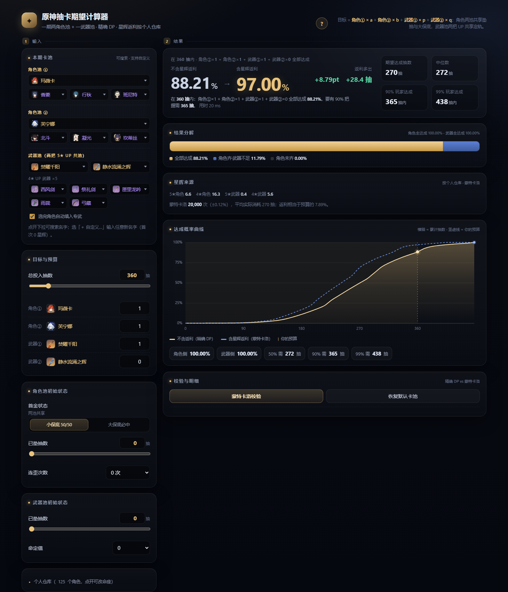

# 原神抽卡期望计算器

给定「投入多少抽」和「要拿到哪些角色 / 武器各几个」，算出**全部达成**的概率——分别给出**不含星辉返利**（精确 DP）和**含星辉返利**（蒙特卡洛）两个数字，并画出完整的达成概率曲线。

纯前端、零依赖、双击即用，不需要装任何东西。



## 它算什么

一期卡池 = **两个角色池 + 一个武器池**，目标是四个独立计数：

> 角色① × a、角色② × b、武器① × p、武器② × q

输出：

| 指标 | 说明 |
|---|---|
| 不含星辉返利 | 只用预算能达成的概率，状态机精确递推，无采样误差 |
| 含星辉返利 | 把抽卡返还的星辉换成抽数后的实际达成率（蒙特卡洛，约 2.7 万次） |
| 返利多出 | 两者的差值（百分点）与平均多抽数 |
| 曲线 | 横轴为预算抽数，金色实线 = 不含返利，蓝色虚线 = 含返利 |
| 分解 | 全部达成 / 角色齐但武器不足 / 角色未齐 |
| 分位数 | 50% / 90% / 99% 的玩家分别在多少抽内达成 |

默认参数（2 角色 + 1 武器，360 抽）结果：**88.21% → 约 96.9%，返利相当于多 27 抽**。

## 快速开始

```bash
git clone <repo>
cd GenshinGachaCalc     # 或直接下载 zip 解压
```

双击 `index.html`。首次打开会弹出使用说明。

`data/roster.json` 是**空的**（所有角色 -1、武器未拥有）。展开左栏「个人仓库」填命座和武器，星辉返利才会准；填完点「导出 roster.js」覆盖 `data/` 下的同名文件即可保存。

## 功能

- **卡池选择**：下拉带搜索框，候选显示头像 + 名字，按星级着色；支持「＋ 自定义…」输入任意新角色 / 武器（首次 0 星辉）
- **自动匹配专武**：选完五星角色，武器池自动填入其专属武器（可关闭）
- **目标与预算**：1–2500 抽滑块 + 手动输入；四个目标各自计数，每行显示对应 UP 的头像和名字
- **初始状态**：角色池已垫抽数 / 首金小保底或大保底 / 连歪次数；武器池已垫抽数 / 命定值
- **个人仓库**：全部角色命座（0–6，-1 = 未拥有）与武器持有状态，支持导出 `roster.js` / `roster.json`
- **校验**：一键蒙特卡洛复核 DP 结果

## 规则口径

| 项目 | 取值 |
|---|---|
| 角色池 | 0.6% 基础 / 74 抽起每抽 +6% / 90 抽硬保底 |
| 小保底 | 50% 出 UP，歪了下次必中（大保底） |
| 捕获明光 | 5% 概率触发；连歪 3 次必中；综合 UP 率 55.32% |
| 武器池 | 0.7% 基础 / 63 抽起每抽 +7% / 80 抽硬保底 |
| 武器 UP | 75% 出 UP（两把平分 37.5%）/ 命定值上限 1，换定轨清零 |
| 四星池 | 50% 出 UP 四星，其余按「平稳机制」加权；四星综合 13% |
| 星辉返还 | 5★ 角色：首次 0 / 重复 10 / 满命 25；4★：0 / 2 / 5；5★ 武器：0 / 10；4★ 武器：0 / 2 |
| 兑换 | 5 星辉 = 1 抽，不限购 |

角色池①② 共享垫抽、大保底与捕获明光；武器池两把 UP 共池，定轨先①后②。策略「先角色后武器，角色拿齐再抽武器」在给定卡池下是随机占优的。

## 目录结构

```
index.html          页面（样式 + 交互全在里面）
engine.js           精确 DP：角色/武器状态机、卷积、统计量
starlight.js        星辉返利蒙特卡洛（含逐预算 CDF）
gacha.py            单目标 DP 命令行
starlight.py        含返利的命令行
build_data.py       data/*.json → data/roster.js（网页数据包）
build_assets.py     从 bwiki 抓角色头像 / 武器图标到 assets/
build_signature.py  从 bwiki 抓「角色 → 专武」对应
sync_wiki_data.py   抓取最新角色 / 武器 / 常驻池，刷新数据库
fetch_roster.py     可选：从米游社接口同步个人祈愿记录
data/               roster / charstars / weaponstars / signature / banner
tests/              DP 与蒙特卡洛交叉验证
```

## 更新数据

出了新角色 / 武器之后：

```bash
python3 sync_wiki_data.py --dry-run   # 先看差异
python3 sync_wiki_data.py             # 写入并重建 roster.js
python3 build_signature.py            # 刷新专武对应（能抓多少算多少）
python3 build_assets.py               # 补头像 / 图标（可选）
```

`build_assets.py` 可以只跑武器（`--only weapon`）、或跳过详情页（`--fast`）。没装 Pillow 也能跑，只是存原始 PNG。

## 命令行

```bash
# 单目标 DP：360 抽内 2 角色 + 1 武器
python gacha.py --pulls 360 --chars 2 --weapons 1

# 带返利与个人仓库
python starlight.py --pulls 360 --targets 1,1,1,0 \
    --up5a 玛薇卡 --up4a 香菱,行秋,班尼特 \
    --up5b 芙宁娜 --up4b 北斗,凝光,坎蒂丝 \
    --w1 焚曜千阳 --w2 静水流涌之辉

python starlight.py --pull 360 --targets 1,1,1,1 --mc 20000 --json
```

`--targets` 顺序：角色①,角色②,武器①,武器②。

## 精度与已知限制

- 概率递推是**精确**的（状态空间穷举，密度总和为 1），与蒙特卡洛在多组参数下一致
- 软保底曲线的具体形状官方未公示，只有「综合 1.6% / 1.85%」；不同合理假设会让结果波动约 **±1 个百分点**
- 四星概率按 5.1% + 10 抽硬保底建模（综合 13%，与实测 12.84% 吻合）；只影响星辉返利
- 四星非 UP 的「角色 / 武器」由官方**平稳机制**决定：未触发 UP 时按连续未出该类物品的抽数加权
  （角色池 255 起、17 抽后每抽 +2550；武器池 300 起、14 抽后每抽 +3000），不是固定比例。
  实测该机制下角色池四星角色占 72.7%（自抽记录 71.0%），武器池 20.1%（实测 19.3%）
- 只支持一期卡池内的规划；跨期攒抽、集录祈愿、常驻祈愿单独建模暂不支持

## 素材与版权

`assets/` 下的角色头像和武器图标来自 [原神 bwiki](https://wiki.biligame.com/ys)，版权归米哈游所有，**未包含在本仓库中**，请自行运行 `python3 build_assets.py` 生成，仅作个人使用。代码部分可自由使用。
